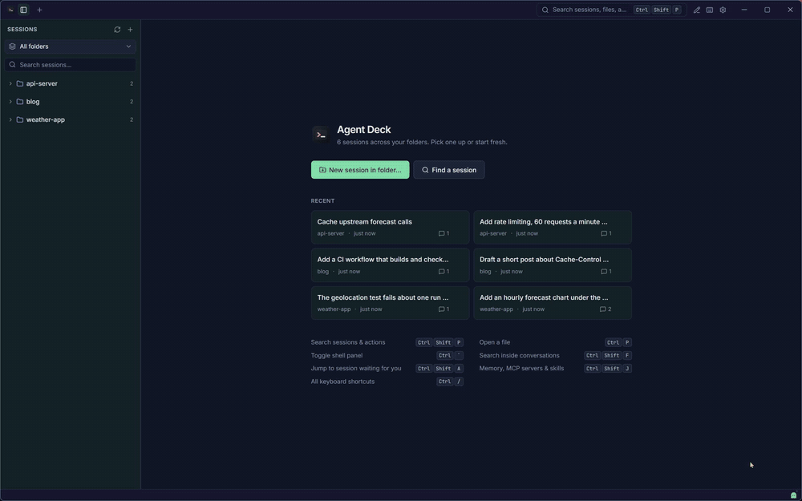

# Agent Deck

A Windows app for your Claude Code and Codex sessions. It lists every session from every folder, lets you read one before you resume it, and runs several side by side.



## Install

1. Download `agent-deck-0.1.1-x64-setup.exe` from [Releases](https://github.com/tushar-mukati-projects/agent-deck/releases).
2. Run it. It installs for your user only, no admin needed.

You need Windows 10 or 11 (x64) and Claude Code or Codex on your PATH. WSL sessions also need `python3` inside the distro.

## Features

- Sessions from Windows and every running WSL distro, grouped by folder.
- Read a session without starting it, then resume or fork it. Search inside every conversation.
- Several sessions at once, one per tab, each in a real terminal with its own shells.
- A file explorer, a code viewer and editor, and the agent's changes as diffs.
- The agent's config in one place: memory files, MCP servers, skills, hooks, permissions and plugins.
- Alerts when an agent finishes or needs approval, plus notes, a command palette and 15 themes.
- Claude Code, Codex and any other CLI agent you add in Settings.

## Shortcuts

| Action | Keys |
|---|---|
| Command palette | `Ctrl+Shift+P` |
| Go to file or folder | `Ctrl+P` |
| Search inside conversations | `Ctrl+Shift+F` |
| New session in this folder | `Ctrl+Shift+N` |
| Next / previous tab | `Ctrl+Tab` / `Ctrl+Shift+Tab` |
| Jump to tab | `Ctrl+1…9` |
| Reopen closed tab | `Ctrl+Shift+T` |
| Jump to the session waiting for you | `Ctrl+Shift+A` |
| Files / Changes / Agent config | `Ctrl+Shift+E` / `G` / `J` |
| Sessions list / session panel | `Ctrl+Shift+B` / `Ctrl+Alt+B` |
| Toggle shell panel / new shell | ``Ctrl+` `` / ``Ctrl+Shift+` `` |
| Find in terminal | `Ctrl+F` |
| Terminal font size | `Ctrl+=` / `Ctrl+-` / `Ctrl+0` |
| Settings | `Ctrl+,` |
| Notes | `Ctrl+Alt+N` |
| Hide mode | `Ctrl+Shift+H` |
| All shortcuts | `Ctrl+/` |

## Build

Needs Node 22.12+, Rust (stable, MSVC) and the Visual Studio C++ build tools.

```powershell
npm install
npm run app:dev      # dev app with hot reload, runs beside an installed copy
npm run check        # typecheck and tests
npm run app:build    # installer in src-tauri\target\release\bundle\nsis
```

## License

MIT. See [LICENSE](LICENSE).
